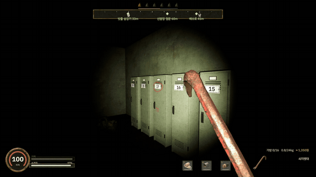
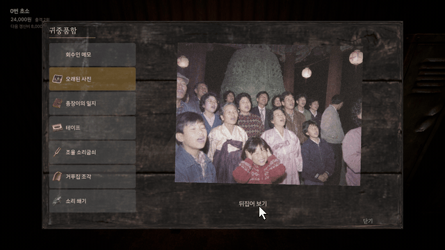
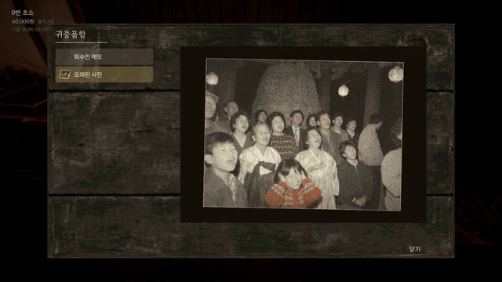
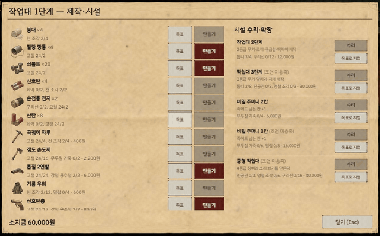
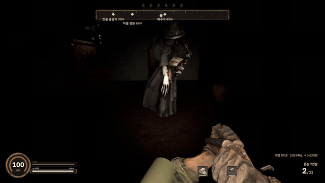
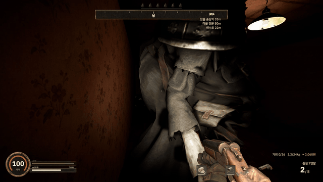

# 울림골

봉쇄된 폐광 마을에 혼자 들어가 쓸 만한 물건을 찾고, 살아서 들고 나오는 1인칭 공포 게임이다. 소리를 내면 무언가가 찾아오고, 죽으면 가방에 담은 것과 들고 있던 장비를 잃는다.

Unity 6(URP)와 C#으로 만들고 있는 개인 프로젝트다.

이 게임에서 가장 만들고 싶었던 건, 간신히 빠져나온 뒤에도 "한 번만 더 들어가 볼까" 고민하는 순간이다. 그런데 직접 몇 판 해 보니 그 고민이 생각보다 빨리 사라졌다.

 

## 돈은 쌓이는데 다시 들어갈 이유가 없었다

한 판의 흐름은 단순하다. 0번 초소에서 준비하고, 마을로 들어가 서랍과 궤짝과 사물함을 뒤진 다음, 열린 출구까지 가서 E를 길게 눌러 빠져나온다. 가져온 물건은 팔거나 재료로 써서 장비를 만들고 초소를 고치는 데 쓴다. 달리거나 총을 쏘거나 벽을 두드리면 그 소리를 듣고 크리처가 온다. 머리에 종을 쓴 '종머리'는 총소리가 난 자리로 곧장 찾아온다.

무엇을 챙기고 무엇을 두고 갈지, 지금 나갈지 한 칸만 더 볼지 고민하는 건 재미있었다. 문제는 그다음이었다. 몇 판 하고 나니 물건을 팔아 돈이 쌓여도 계속 수색할 이유가 약했다. 숫자는 오르는데 다음 판을 시작하는 손이 점점 무거워졌다.

내가 좋아했던 게임들을 떠올려 봤다. 메이플스토리는 새 보스를 잡고 낮은 확률로 좋은 아이템을 얻는 재미로 했고, 림버스 컴퍼니는 다음 이야기가 궁금해서 계속했다. 나를 다시 접속하게 만든 건 결국 그 두 가지였다. 그래서 둘을 하나로 묶어 보기로 했다. 평소처럼 뒤지다가 아주 가끔 이상한 물건이 나오고, 그게 이야기의 시작이 되는 것이다.

## 첫 단서는 우연히, 다음 단서는 정해진 자리에

그렇게 넣은 게 등급이 '???'로 표시되는 오래된 사진이다. 아랫마을에 세 번째로 들어갈 때부터 서랍이나 궤짝 하나에 들어갈 수 있고, 아무리 운이 없어도 여섯 번째에는 나온다. 사진을 그냥 지나쳐도 게임은 평소대로 굴러간다.

사진을 초소의 중개상에게 보여 주고 팔지 않고 남겨 두면, 귀중품함에서 꺼내 볼 수 있다. 뒷면에는 볼펜으로 이렇게 적혀 있다.

> 일지는 선광장 탈의실 
> 17번 사물함에.

여기서 하나 걸리는 게 있었다. 다음 단서까지 확률로 나오게 하면, 이야기가 궁금해진 사람도 운이 따라 줄 때까지 같은 수색을 되풀이해야 한다. 궁금해서 시작한 일이 숙제가 되는 셈이다. 그래서 첫 사진만 우연에 맡기고, 그다음부터는 메모에 적힌 자리에 반드시 있게 했다.

선광장 탈의실에서 입구와 가장 먼 벽에 15번부터 19번까지 사물함을 세우고, 17번에만 붉은 분필로 동그라미를 쳤다. 잠긴 사물함을 3초 동안 비틀어 열면 종장이의 일지와 테이프가 들어 있다.

사진을 넣으면서 계속 스스로에게 물은 건 하나였다. 나라면 이걸 주웠을 때 정말 한 판 더 들어가 보고 싶을까.

## 버튼으로 뒤집는 사진은 사진 같지 않았다

처음에는 사진 아래에 '뒤집어 보기' 버튼이 있었다. 누르면 앞면 그림이 뒷면 그림으로 바뀌었다. 기능은 했다. 이 버전을 해 본 사람이 뒷면 메모를 읽고 어디로 가야 할지 바로 알아내 그 장소를 찾아가는 것도 봤다.

그래도 직접 해 보면 아쉬웠다. 버튼을 누르는 건 메뉴를 고르는 느낌이지, 낡은 사진을 손에 들고 있는 느낌이 아니었다. 내가 원한 건 사진이 손에 든 물건처럼 눈앞에 있고, 마우스로 끌어 이리저리 돌리다가 뒷면에 적힌 글씨를 직접 읽는 것이었다.

그래서 사진을 얇은 3D 카드로 바꾸고 버튼은 없앴다. 마우스로 끌면 앞뒤로도 위아래로도 돌아가고, 메모는 뒷면에 직접 적혀 있다. 뒷면을 0.5초쯤 보고 있으면 메모를 읽은 것으로 치고, 창을 닫으면 "선광장 탈의실, 17번 사물함."이라는 자막이 뜬다. 그때부터 출정 지도의 선광장에 단서 표시가 붙는다.

| 버튼으로 뒤집던 때 | 끌어서 돌리는 지금 |
|---|---|
|  |  |

바꾼 뒤에 처음부터 다시 해 봤다. 출발 전에 사진을 돌려 메모를 읽고, 선광장으로 들어가 17번 사물함에서 일지와 테이프를 꺼낸 다음 밧줄 승강기로 나왔다.

## 동기가 희귀 아이템을 찾았을 때

같은 교육 과정 동기에게 해 보게 한 적이 있다. 수색하다 희귀 아이템이 나오자 손을 멈추고 한참 들여다보더니, 그대로 다음 판으로 넘어갔다. 첫 발견이 흥미를 끄는 건 맞는 것 같았다.

다만 돌아보면 흥미를 보이는 것과 단서를 읽고 다음에 할 일을 알아내는 건 따로 봐야 하는 문제였다. 그때는 반응을 보는 게 좋아서 기록할 생각까지는 못 했다. 다음에는 처음 하는 사람에게 아무 설명 없이 해 보게 하고, 사진을 주운 뒤 17번 사물함까지 혼자 찾아가는지 처음부터 끝까지 적어 둘 생각이다.

 

## 시연 영상

### 사진을 돌려 읽고 17번 사물함까지 (55초)

https://github.com/user-attachments/assets/fa9f8a21-62aa-42bb-97c8-5703852930c2

사진을 끌어 돌려 메모를 읽는 데서 시작해, 출정 지도의 표시를 따라 선광장에 들어가 탈의실 17번 사물함에서 일지와 테이프를 꺼내고, 밧줄 승강기로 나와 회수 보고서를 보는 데까지 담았다.
### 종머리 몸통에 두 발 (12초)

https://github.com/user-attachments/assets/0e5779dc-3ab2-4022-a4d2-43bfde6a8a2e

톱질 2연발로 종머리 몸통에 두 발을 연달아 쏘는 장면이다. 맞을 때마다 몸이 번쩍이고, 두 번째 발에 균형을 잃고 휘청인다. 뒤쪽에는 같은 장면을 느리게 한 번 더 넣었다.
 

## 직접 해 보다 고친 것들

### 작업대에서 뭘 하나 만들면 목록이 맨 위로 올라갔다

작업대에서 목록을 아래로 내려 둔 채 장비를 만들면, 목록이 무조건 맨 위로 올라갔다. 아래쪽에 있는 걸 만들 때마다 다시 내려야 해서 꽤 불편했다. 제작이 끝나면 창을 새로 그리는데, 그때 스크롤 위치도 처음으로 돌아가고 있었다.

그래서 창을 다시 그리기 전에 목록 위치를 기억해 두고, 새 목록이 자리를 잡은 뒤 그 위치로 되돌리게 했다. 사물함과 중개상 창도 같은 식으로 다시 그려지고 있어서 함께 고쳤다.

고친 뒤에는 처음 불편했던 그대로 목록을 내리고 신호탄총을 만들어 봤다. 목록은 보던 자리에 그대로 있었다.

| 고치기 전 | 고친 뒤 |
|---|---|
|  |  |

### 쏘긴 쐈는데 맞은 건지 알 수가 없었다

총을 쏴도 맞는 모션이나 효과가 잘 보이지 않았다. 이 크리처가 원래 안 죽는 건지, 피해는 들어가는지, 애초에 맞히기는 한 건지 구분이 안 됐다.

그래서 피해를 입은 크리처의 몸이 0.15초쯤 밝게 번쩍이게 했다. 종머리는 머리에 쓴 종이 총알을 막는데, 종소리만 듣고는 막힌 건지 맞은 건지 알기 어려웠다. 같은 총으로 몸통과 종을 한 번씩 쏴 보고, 몸통은 피해가 들어가고 종은 막히는 걸 확인했다.

| 고치기 전 | 고친 뒤 |
|---|---|
|  |  |

 

## 여기 올린 것

전부는 아니고 일부만 올려 뒀다. 이 글과 시연 영상 두 개, 고치기 전과 뒤를 나란히 놓은 움짤들, 그리고 위에 적은 부분의 코드 네 개다. Unity 프로젝트 전체와 실행 파일은 올리지 않았다.

- [code/Locker17_excerpt.cs](code/Locker17_excerpt.cs) 첫 사진이 나오는 확률과 17번 사물함 배치
- [code/PhotoStage_excerpt.cs](code/PhotoStage_excerpt.cs) 사진 카드를 끌어 돌리고, 뒷면을 읽었는지 판단하는 부분
- [code/ScrollKeep.cs](code/ScrollKeep.cs) 창을 다시 그려도 목록 위치를 지키는 부분
- [code/HitFlash.cs](code/HitFlash.cs) 맞았을 때 몸이 번쩍이는 효과

코드는 게임의 다른 부분에 기대고 있어서 따로 컴파일되지는 않는다. 어디서 얼마나 옮겼는지는 [code/README.md](code/README.md)에 적어 뒀다.

크리처와 무기, 소품, 재질, UI 그림, 3D 모델, 음성은 Higgsfield로 만들었고 원본 파일은 올리지 않았다. 효과음은 OpenGameArt의 CC0 묶음(Kenney, artisticdude, HaelDB, TinyWorlds, Zane Little Music, AntumDeluge, Ove Melaa, kurt)과 게임 안에서 합성한 소리를 썼다. 글꼴은 IBM Plex Sans KR, 고운바탕, 나눔손글씨 펜, 갈무리이고 모두 SIL Open Font License 1.1이다.
