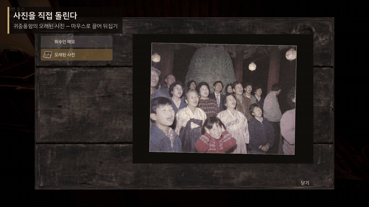
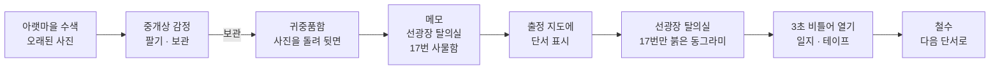
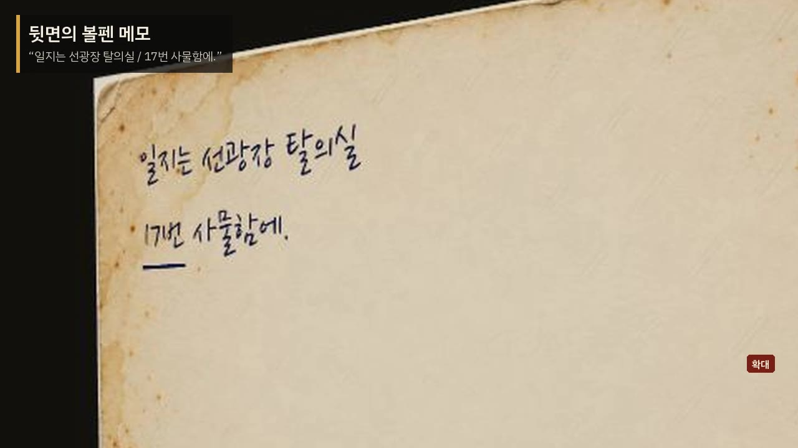
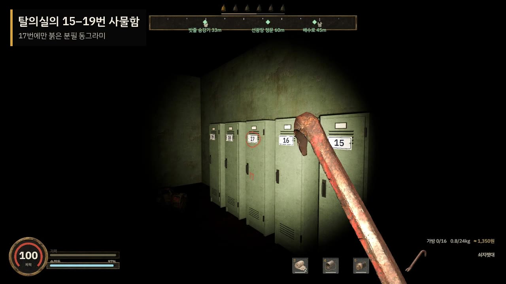
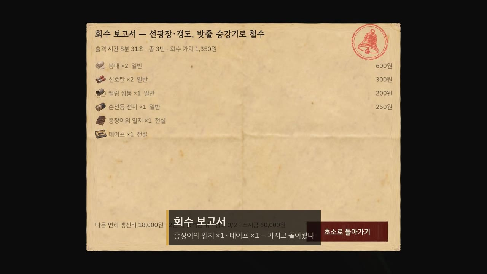
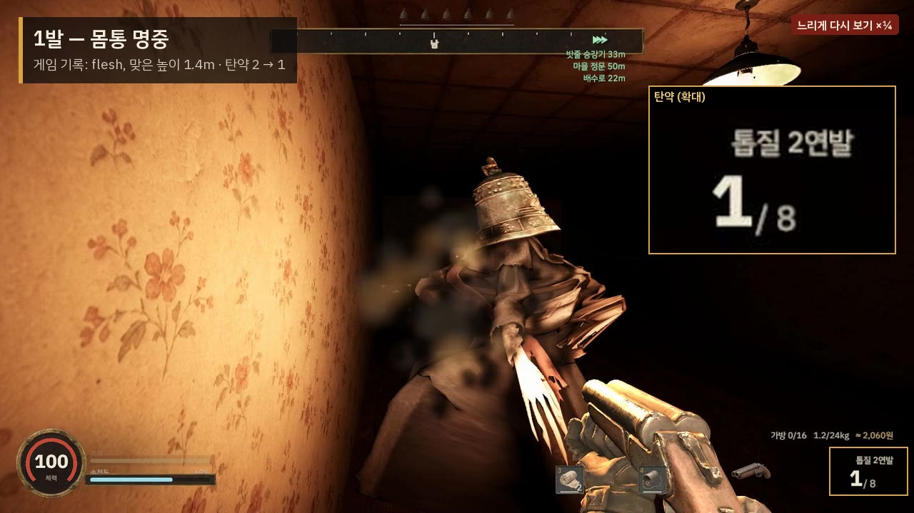
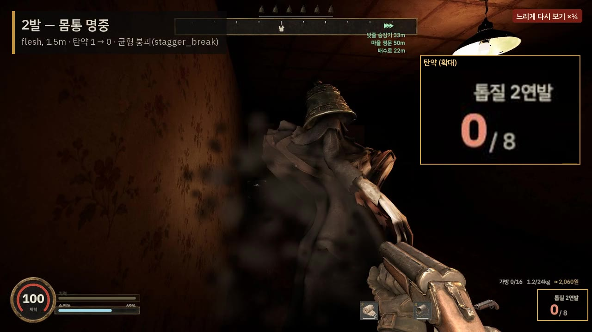
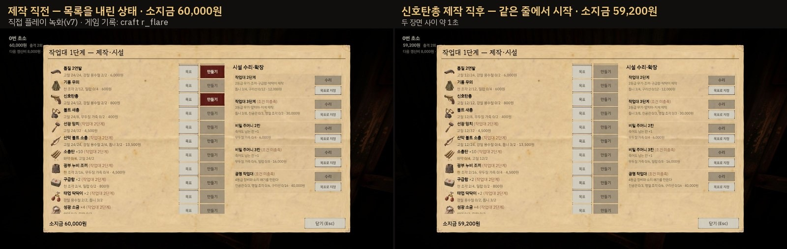

<div align="center">

# 울림골 ULLIMGOL

**사진 한 장의 뒷면이 다음 출격의 목적지가 되는, 1인칭 솔로 수색 · 회수 공포 게임**

봉쇄된 폐광 마을에 혼자 들어가 물건을 찾아 살아서 들고 나옵니다.
소리를 내면 무언가가 찾아오고, 죽으면 가방에 담은 것을 잃습니다.

개인 프로젝트

`Unity 6 (6000.6.4f1)` `URP` `C#` `Input System`

</div>

<br />



> 이 저장소는 **포트폴리오 공개본**입니다. README, v7 빌드 게임 시연 영상과 장면, 선별한 코드 4개만 있고 Unity 프로젝트 · 빌드 · 아트 원본은 없습니다. 내려받아 실행할 수 있는 프로젝트가 아닙니다. 범위는 [PUBLICATION.md](PUBLICATION.md)에 있습니다.

<br />

## 목차

1. [어떤 게임인가](#어떤-게임인가)
2. [사진 단서 — 왜, 어떻게](#사진-단서--왜-어떻게)
3. [시연 영상](#시연-영상)
4. [검증 기록](#검증-기록)
5. [내가 한 일](#내가-한-일)
6. [기술 스택](#기술-스택)
7. [저장소 구조와 공개 범위](#저장소-구조와-공개-범위)
8. [한계](#한계)

<br />

## 어떤 게임인가

```
0번 초소(의뢰판 · 사물함 · 중개상 · 작업대 · 무전기)
 → 출격(아랫마을 → 선광장·갱도 → 주조장·종탑) → 수색 · 회수
 → 열린 출구로 철수(배수로 · 밧줄 승강기 · 정문) → 정산 · 제작 · 시설 수리 → 다시 출격
```

- **수색**: 서랍 · 궤짝 · 사물함을 열어 시간을 들여 뒤지고, 담을 것을 고릅니다. 잠긴 사물함은 E를 길게 눌러 비틀어 엽니다
- **소리**: 달리기 · 총성 · 벽 두드리기(G) 소리를 크리처가 듣고 찾아옵니다. 머리에 종을 쓴 '종머리'는 총성을 듣고 쏜 자리로 옵니다
- **철수**: 출구까지 가서 E를 길게 눌러야 가져옵니다. 죽으면 가방과 장착 장비를 잃습니다
- **이야기**: 아랫마을에서 우연히 나오는 오래된 사진에서 시작해, 정해진 장소의 단서를 따라갑니다

<br />

## 사진 단서 — 왜, 어떻게

**제가 느낀 문제**: 직접 플레이해 보니 물건을 팔아 돈이 쌓여도 계속 수색할 이유가 약했습니다.

**정한 규칙**
- **첫 단서는 우연히**: 오래된 사진(`???`)은 아랫마을 세 번째 출격부터 서랍 · 궤짝 하나에 들어가고, 늦어도 여섯 번째 출격에는 반드시 나옵니다
- **다음 단서는 고정된 장소에**: 후속 단서까지 희귀하면 이야기가 궁금한 사람도 운이 좋을 때까지 같은 수색을 반복해야 합니다. 그래서 사진 뒷면 메모에 적힌 장소(선광장 탈의실 17번 사물함)에 일지와 테이프가 반드시 놓이게 했습니다



- 사진은 손에 든 물건처럼 3D 카드로 나옵니다. 마우스로 끌면 앞뒤 · 위아래로 돌아가고, 뒷면에 볼펜 메모가 직접 적혀 있습니다. 예전의 `뒤집어 보기` 버튼은 없앴습니다(v7)
- 뒷면을 0.5초 이상 보면 메모를 읽은 것으로 치고(`photo_back`), 창을 닫으면 "선광장 탈의실, 17번 사물함." 자막이 뜹니다
- 그때부터 출정 지도의 선광장에 "탈의실 17번 사물함 — 사진 뒷면" 표시가 붙습니다. 선광장 맵을 만들 때 입구에서 가장 먼 탈의실 벽에 15–19번 사물함 줄을 세우고, 17번에만 붉은 분필 동그라미를 칠합니다
- 코드: [code/Locker17_excerpt.cs](code/Locker17_excerpt.cs) · [code/PhotoStage_excerpt.cs](code/PhotoStage_excerpt.cs)

<br />

## 시연 영상

### 1. 사진 단서 본편 — 55초 · v7 게임 시연

https://github.com/user-attachments/assets/fa9f8a21-62aa-42bb-97c8-5703852930c2

영상이 재생되지 않으면: [MP4 파일 5.0MB](media/ullimgol-v7-demo-photo-clue.mp4)

| 시간 | 장면 |
|---|---|
| 0:02–0:10 | 마우스로 끌어 사진을 뒤집고 뒷면 메모를 읽음(0:07부터 화면 확대) |
| 0:10–0:18 | 자막 "선광장 탈의실, 17번 사물함." → 출정 지도의 단서 표시 → 출정 |
| 0:18–0:26 | 선광장 도착(탈의실까지 걸어간 약 3분은 잘라 냄) → 15–19번 중 17번의 붉은 동그라미 |
| 0:26–0:40 | 비틀어 열기 → 종장이의 일지 · 테이프 → 모두 담기(가방 2/16칸) |
| 0:40–0:55 | 밧줄 승강기로 철수 → 회수 보고서에 일지 ×1 · 테이프 ×1 |

| 뒷면 메모(확대) | 17번 사물함 | 회수 보고서 |
|---|---|---|
|  |  |  |

> 사진을 보관했고 뒷면은 아직 읽지 않은 테스트 저장(`locker17` 시나리오)으로 시작했고, 무적 옵션을 켰습니다. 걸어가는 구간, 승강기를 기다리는 동안 크리처가 다가온 장면은 잘라 냈습니다. 게임 안 녹화가 초당 약 18.6장이라 움직임이 조금 끊겨 보입니다.

### 2. 종머리 몸통 연속 사격 — 12초 · v7 게임 시연

https://github.com/user-attachments/assets/0e5779dc-3ab2-4022-a4d2-43bfde6a8a2e

영상이 재생되지 않으면: [MP4 파일 2.3MB](media/ullimgol-v7-demo-bellhead-body-shots.mp4)

| 시간 | 장면 |
|---|---|
| 2.4–5.1초 | 실시간: 장전된 톱질 2연발(탄약 2)로, 벽을 두드리지 않고 총이 화면에 보이는 상태에서 몸통에 약 0.4초 간격으로 두 발 |
| 5.1–11.6초 | ¼ 속도로 다시 보기: 6.3초 1발(탄약 2 → 1), 7.8초 2발(1 → 0) 뒤 균형이 무너져 휘청 |

| 1발 — 몸통 명중 | 2발 — 몸통 명중 · 휘청 |
|---|---|
|  |  |

> `bellhead_hit` 테스트 시나리오로 찍었습니다. 이 시나리오는 무적이고, 여러 종류의 타격을 견디도록 종머리 체력을 3000으로 올려 둡니다. 게임 기록은 `impact Bellhead flesh h1.4` → `impact Bellhead flesh h1.5` → `stagger_break`입니다. 같은 녹화에서 먼저 쏜 두 번(두 번째 발이 종에 막힘 · 빗나감)은 쓰지 않았습니다.

<br />

## 검증 기록

### 사진 단서 — 동료 반응과 제 직접 확인

| 무엇 | 누가 | 결과 |
|---|---|---|
| 희귀 아이템을 얻었을 때 | 같은 교육 과정 동료(관찰) | 관심을 보이며 플레이를 이어 감 |
| 버튼으로 뒤집던 이전 버전 | 플레이어(관찰) | 사진 뒷면 메모를 읽고 어디로 갈지 알아내 그 장소를 찾아감. 같은 사람인지, 미리 설명했는지는 기록이 없음 |
| 조작 변경 | 저 | "버튼으로 뒤집기"를 "잡아 돌려 읽기"로 바꾸기로 정함, v7에 반영 |
| v7 직접 확인 | 저 | 사진을 보관한 테스트 저장에서 사진을 끌어 돌려 뒷면을 읽음(`story photo_back`) → 선광장 출격 → 17번 사물함에서 일지 · 테이프 회수(`got_journal` · `got_tape`) → 밧줄 승강기로 철수 |

같은 흐름은 [시연 1](#1-사진-단서-본편--55초--v7-게임-시연)에서 볼 수 있습니다. 이 과정에서 첫 단서에 흥미를 보이는지와, 단서를 읽고 다음 행동을 알아낼 수 있는지를 따로 살펴야 한다는 것을 배웠습니다. 제 직접 확인 녹화와 기록 원본은 공개본에 넣지 않았습니다.

### 작업대 목록 위치 — 신호탄총 제작 전 · 후

**문제**: 작업대에서 목록을 아래로 내린 채 장비를 만들면 목록이 맨 위로 돌아갔습니다(제가 플레이하다 발견).

**기대 동작**: 제작 직전에 보던 목록 위치를 그대로 유지합니다.

**수정(v7)**: 창을 다시 그리기 전에 각 목록의 스크롤 위치를 기억했다가, 새로 그린 목록의 배치가 잡힌 뒤 되돌립니다. 사물함 · 중개상처럼 다시 그려지는 다른 창에도 같이 적용했습니다. [code/ScrollKeep.cs](code/ScrollKeep.cs)

**확인(제 직접 플레이)**: 같은 순서로 목록을 내린 뒤 신호탄총을 만들었습니다. 게임 기록에 `craft r_flare`가 남았고, 소지금은 60,000원에서 59,200원으로 줄었으며, 제작 전후 목록 맨 위 줄은 같은 '톱질 2연발'이었습니다.



> 제 직접 플레이 녹화에서 뽑은 두 장면입니다. 6초 무렵 목록 맨 위는 '붕대'였고, 9초에 아래로 내려 '톱질 2연발'이 맨 위가 된 상태에서 14.5초에 만들었습니다.

### 맞았는지 보이게 — 피해 반응과 종머리

- **문제**: 적에게 피해가 들어가는 순간을 알아보기 어려웠습니다
- **수정(v6)**: 피해를 입은 생물의 몸이 약 0.15초 동안 밝게 번쩍입니다. [code/HitFlash.cs](code/HitFlash.cs)
- **확인(제 직접 플레이)**: 종머리의 몸통과 머리의 종을 같은 톱질 2연발로 각각 쐈습니다. 종소리만으로는 막혔는지 알기 어려웠고, 게임 기록에서 몸통은 피해(`flesh`), 종은 방어(`bronze blocked`)로 판정된 것을 확인했습니다
- **게임 시연**: 몸통 연속 명중, 탄약 변화, 맞을 때마다의 반응([시연 2](#2-종머리-몸통-연속-사격--12초--v7-게임-시연))

<br />

## 내가 한 일

- 게임 방향과 규칙 결정(예: 사진 단서 설계)
- 플레이하며 문제를 찾고, 재현 순서와 기대 동작 정리
- 수정본에서 문제가 생겼을 때와 같은 조작을 반복해 직접 확인
- 동료 반응 관찰
- 공개 범위 결정

<br />

## 기술 스택

| 영역 | 내용 |
|---|---|
| 엔진 | Unity 6 (6000.6.4f1), URP, Input System, Windows 64비트 독립 실행본 |
| 언어 | C# |
| 아트 · 소리 | Higgsfield로 생성한 이미지 · 3D 모델 · 음성, OpenGameArt CC0 효과음, 게임 안 합성음, OFL 글꼴 |
| 확인 도구 | 테스트 시나리오(`-scenario`), 게임 안 녹화(`-record`), 게임 기록(playlog) |

<br />

## 저장소 구조와 공개 범위

```
README.md          이 문서
PUBLICATION.md     들어 있는 것 · 넣지 않은 것 · 영상 속 자료와 권리
media/             v7 게임 시연 영상 2개와 장면, 작업대 전후 비교(제 직접 플레이 녹화)
code/              선별 코드 4개(작업본에서 옮김, 단독 컴파일 불가) · code/README.md
```

- **들어 있는 것**: 이 README, v7 게임 시연 영상 2개와 그 장면, 제 직접 플레이 녹화에서 뽑은 작업대 두 장면, 선별 코드 4개
- **넣지 않은 것**: Unity 프로젝트 전체, 빌드 · 압축본, 게임 기록 · 녹화 원본, 테스트 저장, Higgsfield 생성물 원본, 효과음 · 글꼴 파일, 기획 문서와 이야기 초안, 개인 정보
- 자세한 범위와 권리: [PUBLICATION.md](PUBLICATION.md) · 코드 범위: [code/README.md](code/README.md)

<br />

## 한계

- 실행 파일과 Unity 프로젝트가 없어 이 저장소만으로는 게임을 해 볼 수 없습니다
- 선별 코드는 최신 작업본에서 옮겼습니다. v7 이후 이야기 · 크리처를 바꾼 작업이 있어, 사진 앞면 그림과 메모 문구를 만드는 부분은 빼고 올렸습니다
- 사진 단서에 대한 동료 반응은 소수의 비공식 관찰입니다
- 시연 영상은 무적 옵션과 테스트 시나리오로 찍어, 실제 난이도(죽을 위험, 길 찾는 시간)를 그대로 보여 주지 않습니다
- Higgsfield 생성물의 배포 조건은 서비스 약관을 따르므로, 아트 원본은 올리지 않고 플레이 화면만 실었습니다
